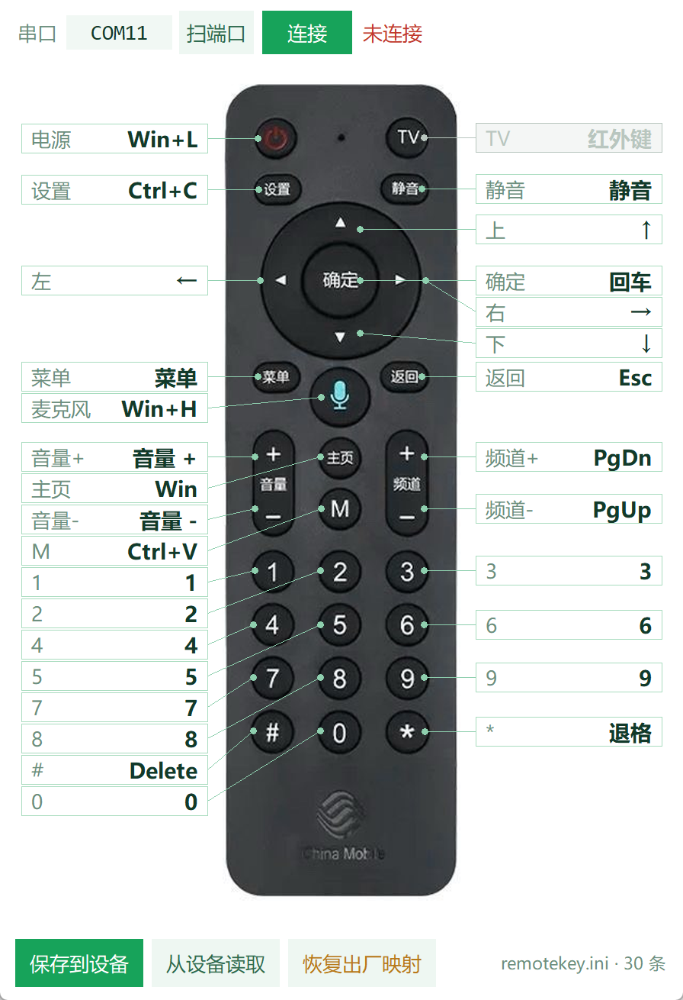
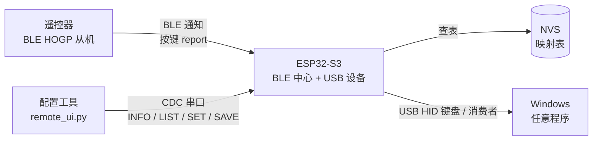
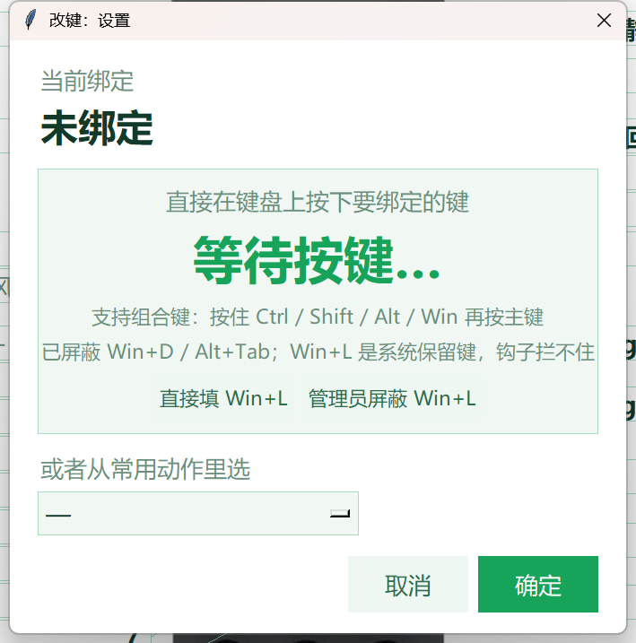

# CMCC 语音遥控器 → USB HID 桥

把一只 **Windows 不认的移动定制蓝牙语音遥控器**，改成插上就能用的 USB 键盘：
每个键映射成什么，用图形界面点一下就能改。



<sub>中文 | [English summary](#english-summary)</sub>

---

## 这是什么

图中这只 **CMCC 语音遥控器**（机顶盒/电视盒子配件，讯飞 XFRCB22 方案，主控 RTL8762C）本身是标准的
BLE HID over GATT 设备。但它在 Windows 上**配对成功后也收不到任何按键**——设备管理器稳定报
「该设备无法启动（代码 10）」。

本项目用一块 **ESP32-S3** 同时扮演两个角色解决这个问题：

- **对遥控器**：做一个通用 BLE 中心（central），像手机一样正常订阅 9 个 HID Report 特征，拿到每一次按键；
- **对电脑**：做一个标准 USB 复合设备（HID 键盘 + 消费者控制 + CDC 串口），把按键翻译成真正的键盘输入。

映射表存在 ESP32 的 NVS 里，断电不丢；插上电脑就是一个键盘，不装驱动、不装后台程序。
想改键时打开 `pc/remote_ui.py`（或打包好的 exe），点一下遥控器照片上的任一个键，按你要绑的键，
再「保存到设备」即可。

---

## 为什么需要它

不是驱动没装，也不是配对没成功。Windows 的蓝牙 HID 栈（`mshidumdf`）在初始化前会严格核对
每个 Report 特征的 **Report Reference 描述符** 与 **Report Map** 里声明的 report ID / 类型是否一致。
这只遥控器有 9 个 Report 特征，其中 3 个的 Reference 与 Map 对不上（`btsnoop` 抓包逐字节比对确认，
见 `tools/hci/verify_hid.py`），严格校验直接拒绝初始化 → 代码 10 → 一个按键都收不到。

而对 BLE 中心来说，`0x1812` 只是一组普通 GATT 特征，没有那套校验。
所以**同一只遥控器，安卓手机、ESP32 都能正常读到按键上报，只有 Windows 蓝牙栈不行**。

结论：不要在 Windows 蓝牙栈上硬修，直接把遥控器从 Windows 的蓝牙里「摘出来」——
由 ESP32 当主机收按键，再以 USB 键盘身份交给 Windows。

> 项目早期还做过一版「手机中继」方案（安卓当 HID 主机 + ADB 转发 + `SendInput` 注入），
> 能用但依赖手机常插、会重复消费按键。已归档到 `tools/android-relay/`，仅作参考。

---

## 硬件

| 物品 | 说明 |
|---|---|
| CMCC 语音遥控器 | 型号 `CMCC_Voice_Remote`，BLE 广播名固定；不需要拆机、不需要改硬件 |
| ESP32-S3 开发板 | 任意带 **USB-OTG** 口的 S3 板（ESP32-S3-DevKitC、S3 mini 等均可）。**注意插 OTG 那个 USB 口，不是 UART 口** |
| USB 数据线 | 一根，同时供电和传输 |

其他 ESP32（S2/S3/C3）理论上 S2/S3 可用，本项目只在 **ESP32-S3 + Arduino-ESP32 3.3.12** 上验证过。
普通 ESP32（无原生 USB）**不行**——它没有 USB OTG，做不了 HID 设备。

---

## 工作原理



ESP32 通过一根 USB 线同时暴露三个身份：

| 接口 | 作用 |
|---|---|
| HID 键盘 | 映射后的普通按键与组合键（修饰键 0xE0–0xE7） |
| HID 消费者控制 | 音量 +/−、静音这类多媒体键 |
| CDC 串口 | 给配置工具读写映射表（默认 115200） |

按键标识 `id = (源 << 12) | usage`：源 `1` = 键盘报告里的 usage（如 `0x1004`），
源 `2` = 消费者报告里的 usage（如 `0x20E9` 音量+）。

---

## 快速开始

### 1. 烧固件

仓库里有两个固件，按需要选一个（两个都保留，不会互相影响）：

| 目录 | 说明 |
|---|---|
| `firmware/cmcc_s3_bridge_v3auto_20261029_0051/` | **推荐**。不写死任何设备信息，靠广播自动识别遥控器 |
| `firmware/cmcc_s3_bridge/` | 最早一版。`TARGET_ADDR` 写死了一只遥控器的 MAC，换设备要改一行重烧 |

两者的串口命令、NVS 映射表格式完全一致，`remotekey.ini` 也可以直接通用，可以随时换。

用 Arduino IDE 打开对应目录里的 `.ino`：

- 开发板：**ESP32S3 Dev Module**
- **USB CDC On Boot：Enabled**（否则 `Serial` 不走 USB，配置工具连不上）
- USB Mode 保持默认
- 其余默认

或者用命令行（与本项目实测配置一致）：

```bash
FQBN="esp32:esp32:esp32s3:USBMode=default,CDCOnBoot=cdc"
arduino-cli compile --fqbn "$FQBN" firmware/cmcc_s3_bridge_v3auto_20261029_0051
arduino-cli upload  --fqbn "$FQBN" -p COM11 firmware/cmcc_s3_bridge_v3auto_20261029_0051
```

> **`upload` 报 `No serial data received` 是正常的。** S3 的 USB 口走 USB Serial/JTAG +
> TinyUSB CDC，不响应 esptool 的标准复位序列。先让它进下载模式再传，三种办法任选：
> 串口发 `BOOT`（固件自带，最省事）、拨 1200 波特率触发、
> 或手动按住 **BOOT** 再点 **RST**。见 [`docs/build.md`](docs/build.md)。

**v3 不需要改 MAC。** 第一次连上会把遥控器地址记进 NVS，之后开机直接找它。
换另一只遥控器时要先清掉旧地址：串口发 `TARGET CLEAR`。

**用 v1 的话，第一次务必改这一行**（`cmcc_s3_bridge.ino` 顶部）：

```cpp
static const char *TARGET_ADDR = "0c:f3:cc:63:10:e3";   // 改成你自己遥控器的 MAC
```

不知道 MAC 就先用配置工具或串口终端发 `SCANDUMP 1`，然后按一下遥控器任意键，
日志里会出现 `# ADV <地址> rssi=... name='CMCC_Voice_Remote'`，把它抄过来。

### 2. 插上电脑

设备管理器里应该出现：1 个键盘、1 个「符合 HID 标准的消费者控制设备」、1 个 COM 口。
第一次插可能需要几秒枚举。

### 3. 改键

```bash
pip install -r pc/requirements.txt
python pc/remote_ui.py
```

打开后：**扫端口 → 连接 → 点遥控器照片上任意一个键 → 按你要绑的键 → 保存到设备**。

---

## 改键：图形界面

主界面把遥控器照片当背景，每个键引一条线到左右两侧的文本框，框里就是它当前的动作。
点文本框弹出录键窗：



- **直接按键盘**：支持组合键（按住 Ctrl / Shift / Alt / Win 再按主键），最多 4 个键同时按下；
- **从下拉里选**：常用动作（音量 +、静音、Esc、Delete、方向键……）直接选，不用背键名；
- 录键期间**键盘会被本程序接管**：Win+D（回桌面）、Win+E（资源管理器）、Alt+Tab 都不会真的触发，
  所以你录 `Win+D` 这类组合不会被系统抢走；
- **Win+L 是例外**：锁屏是系统安全保留动作，键盘钩子拦不住。弹窗里给了两个出口——
  「直接填 Win+L」（不按键盘、绝不会锁屏）和「管理员屏蔽 Win+L」（弹一次 UAC，临时关掉锁屏策略，
  关窗自动还原）；
- 改完点 **保存到设备**（写进 ESP32 的 NVS），下次插上就生效；同时会回写一份 `remotekey.ini`。

顶栏还能「从设备读取」（把设备当前映射读回来）、「恢复出厂映射」。

---

## 配置文件 `remotekey.ini`

程序启动时的取值顺序：**同目录有 `remotekey.ini` 就用它，没有就按固件默认生成一份**。
这个文件可以直接用记事本改，保存后重开程序生效。

```ini
; 注释以分号开头
; 写法：F5 / 回车 / Delete / ↑ / Win+L / Ctrl+Shift+Esc / 音量 + / 留空表示不响应
[keys]
电源 = Win+L
TV =
设置 = Ctrl+C
静音 = 静音
```

注意两点：

1. **`#` 是键名，不是注释符**（`# = Delete` 是合法的一行），注释只能用 `;`
2. `TV = `（留空）表示这个键不做任何响应，不是错误

完整示例见 [`remotekey.sample.ini`](remotekey.sample.ini)。

---

## 串口协议

配置工具通过 CDC 串口用**纯文本行协议**读写映射，16 位十六进制不带 `0x`，行尾 `\n`，
以 `#` 开头的行是日志，客户端忽略即可。

| 命令 | 作用 | 典型返回 |
|---|---|---|
| `INFO` | 版本/条数/连接状态 | `OK INFO ver=1 binds=33 connected=1 ...` |
| `LIST` | 列出全部映射 | `B 1066 1 2 E3 0F` … `OK LIST` |
| `SET <id> <outType> <n> <k...>` | 写一条映射 | `OK SET 1066` |
| `DEL <id>` | 删一条 | `OK DEL 1066` |
| `SAVE` | 写进 NVS | `OK SAVE` |
| `REPORTS` | 列出 9 个 report 特征 | `R 0 id=0x01 type=1 h=0x0025 …` |
| `RAW 1/0` | 打印原始帧（调试） | `OK RAW 1` |
| `LEARN 1/0` | 学习模式 | `OK LEARN 1` |
| `SCANDUMP 1/0` | 打印扫描到的 BLE 广播 | `OK SCANDUMP 1` |
| `ENABLE 1/0` | 总开关 | `OK ENABLE 1` |
| `RESET` / `DEFAULTS` / `CLEAR` | 恢复默认 / 只改内存 / 清空 | `OK RESET` |
| `BOOT` / `REBOOT` | 跳下载模式 / 重启 | `OK BOOT` |

完整字段含义、应答与错误码见 [`docs/protocol.md`](docs/protocol.md)。

---

## 默认映射

出厂默认 28 条（固件里的 `DEFAULTS[]`）；设备里实际存了多少条以 `LIST` 为准
（烧完固件后第一次上电是 28 条，之后你自己加的会继续追加）。
摘几条最能说明问题的：

| 遥控器键 | 默认动作 | 备注 |
|---|---|---|
| 电源（关机） | `Win+L` | 锁屏。想彻底不响应就清空 |
| 录音（麦克风） | `Win+H` | 唤起 Windows 语音键入，用的是**电脑**麦克风 |
| 设置 | `Ctrl+C` | 复制 |
| M | `Ctrl+V` | 粘贴 |
| `#` | `Delete` | 遥控器上没有 Del 键，借用 # |
| 频道 + / − | `PageDown` / `PageUp` | 翻页 |
| 音量 + / − / 静音 | 消费者控制 0xE9 / 0xEA / 0xE2 | 系统音量 |
| 方向键 / OK / 返回 / 主页 / 菜单 | ↑↓←→ / 回车 / Esc / Win / 菜单键 | — |
| TV | **无** | 这只遥控器的 TV 键走红外直发，蓝牙侧一帧不发，物理上救不回来 |

全表见 [`docs/keymap.md`](docs/keymap.md)。

---

## 已知限制

1. **TV 键无效**。实测按住 3 次、600 秒抓包窗口内零帧（连空白报告都没有），同一窗口下音量+ 正常上报，
   说明是遥控器固件把 TV 键直接交给了红外发射，蓝牙链路里根本没有这个键。
2. **语音键只是唤起 Windows 语音输入**，用的是电脑麦克风。遥控器自带麦克风的私有通道
   （service `0x6287` / report `0xFC`）尚未解开：订阅后链路会被遥控器断开，音频编码也不是标准 IMA ADPCM
   （熵 7.35 比特/样本），仍在 `tools/hci/experiments/` 里留了复现脚本。
3. **v1 固件硬编码了目标 MAC**（`firmware/cmcc_s3_bridge/`），换遥控器必须改一行再烧。
   v3 已去掉这个限制，改为广播打分自动识别 —— 但默认识别条件（HID Appearance `0x03C0`–`0x03C4`、
   服务 UUID `0x1812`）**只在一种遥控器上验证过**，换型号能否认出取决于它的广播内容，
   见 [`docs/auto-identify_20261029_0051.md`](docs/auto-identify_20261029_0051.md)。
4. **只支持 Windows 侧的配置工具**。固件本身是标准 USB HID，Linux/macOS 插上也能当键盘用，
   但改键工具是 Tkinter + Win32 钩子写的，只在 Windows 上跑。
5. **必须用 ESP32-S3（或 S2）**，普通 ESP32 没有 USB OTG。

---

## 常见问题

<details>
<summary><b>设备管理器报「代码 10」/ 配对后收不到按键</b></summary>

这是本项目存在的**原因**，不是故障。Windows 蓝牙栈严格校验 HOGP 的 Report Reference 与 Report Map，
这只遥控器有 3 处对不上，所以永远连不上。请按本项目的链路走（ESP32 收 + USB HID 出），
不要试图在 Windows 蓝牙里修。
</details>

<details>
<summary><b>双击 exe 提示「智能应用控制已阻止可能不安全的应用」</b></summary>

Windows 11 的 Smart App Control 按**文件哈希**走微软云端信誉库，未知的新 exe 一律拦，
**和键盘钩子无关，也不是杀毒软件误报**。三条路：

1. **用 `pc/run.bat` 或 `pythonw remote_ui.pyw` 启动**（推荐，python 本身是微软信任的签名程序）；
2. 自己用 `pc/build_exe.bat` 重新打包（换了哈希还是会被拦，除非你的机器已关 SAC）；
3. 买代码签名证书（OV 约 ¥1200/年，EV 约 ¥2500/年）。

关闭 SAC 是不可逆操作（微软明说关掉后无法再开，只能重装系统），不建议为此关闭。
</details>

<details>
<summary><b>串口打不开 / 提示被占用</b></summary>

- 换一个 COM 号再试（`扫端口` 刷新）；
- 关掉占用它的程序：串口助手、Arduino 串口监视器、上次没退干净的 `python.exe`；
- 如果设备插拔过，端口号会变，重新「扫端口」。

实测遇到过 **COM10 被残留句柄占着、换 COM11 立刻正常** 的情况——不是驱动问题。
</details>

<details>
<summary><b>遥控器连不上（一直重试）</b></summary>

1. 确认 `TARGET_ADDR` 填的是**你自己**遥控器的 MAC；用 `SCANDUMP 1` 打印广播核对；
2. 按一下遥控器任意键再等 10 秒——这只遥控器按键唤醒后**只广播很短一段时间**，冷着是扫不到的；
3. 别在手机/电视上同时连着它，HOGP 通常只接受一个主机；
4. 串口日志里 `# 连接失败` 连续出现时，先 `REBOOT` 一次。
</details>

<details>
<summary><b>录 Win+L 时电脑锁屏了</b></summary>

Win+L 是 Windows 的安全保留动作，`WH_KEYBOARD_LL` 能拦别的热键（Win+D、Win+E、Alt+Tab 实测都能拦），
拦不住它——判定发生在钩子之外。弹窗里两个按钮就是为此准备的：**直接填 Win+L**，或
**管理员屏蔽 Win+L**（临时写 `DisableLockWorkstation` 策略，关窗还原）。
</details>

---

## 仓库结构

```
.
├── firmware/
│   ├── cmcc_s3_bridge_v3auto_20261029_0051/  固件 v3：去掉写死设备信息，广播打分自动识别
│   ├── cmcc_s3_bridge/      固件 v1：最早一版，TARGET_ADDR 写死一只遥控器
│   └── cmcc_probe/          早期 BLE 特征探测 sketch（只用来 dump，不产出按键）
├── pc/                      配置工具（Tkinter，单文件可运行）
│   ├── remote_ui.py         主程序
│   ├── assets/              背景图、图标、原始照片
│   ├── make_bg.py           照片 -> 白底背景（裁白边，免得运行时依赖 Pillow）
│   ├── find_keys.py         自动定位每个键的坐标（连通域分析）
│   ├── check_layout.py      布局自检：引线端点是否落在正确的键上
│   ├── shot.py / shot_dlg.py 截图自检
│   ├── test_*.py            各阶段自检（部分需要接硬件）
│   ├── CMCC_RC_Keys.spec    PyInstaller 打包配置
│   └── build_exe.bat        一键打包
├── tools/                   逆向与分析脚本（见 tools/README.md）
│   ├── ble/                 BLE 直连抓取（bleak）
│   ├── hci/                 btsnoop / HCI 日志解析、报告表校验
│   ├── uart/                遥控器调试焊盘串口嗅探
│   └── android-relay/       手机中继方案（已归档）
├── docs/                    原理、协议、键表、编译、故障排查
└── remotekey.sample.ini     配置文件示例
```

---

## 开发与自检

```bash
pip install -r pc/requirements.txt

# 不需要硬件
python pc/test_ini.py            # ini 读写往返
python pc/test_combo.py          # 下拉项 -> 动作 全量解析
python pc/test_shield3.py        # 热键屏蔽 / Win+L 策略 / 钩子看门狗

# 需要接上 ESP32
python pc/test_live.py           # 连设备 读映射 截图
python pc/test_save.py           # 连接 -> 保存 -> 读回比对
python pc/test_roundtrip.py      # 改键 -> 下发 -> 回读
```

注意：GUI 自检要用**装了 tkinter 的 Python**（Windows 官方安装包默认带）。
打包：`pc\build_exe.bat`（PyInstaller 6.x，产物 `pc\dist\CMCC_RC_Keys.exe`，不带进仓库，走 Releases）。

---

## 致谢

- [Arduino-ESP32](https://github.com/espressif/arduino-esp32)（Apache-2.0）——`USBHIDKeyboard` / `USBHIDConsumerControl` / `BLEDevice`
- [TinyUSB](https://github.com/hathach/tinyusb)（MIT）——复合 USB 设备
- [bleak](https://github.com/hbldh/bleak)（MIT）——BLE 直连抓取脚本
- [pyserial](https://github.com/pyserial/pyserial) / [Pillow](https://github.com/python-pillow/Pillow) / [PyInstaller](https://github.com/pyinstaller/pyinstaller)

本项目对所有抓包与逆向工作只使用**自己拥有的设备**，不涉及任何加密内容破解。

---

## 许可

[MIT](LICENSE)。改硬件有风险（供电、静电、刷坏固件），一切后果自负；
本项目和遥控器厂商、运营商无关。

---

<a id="english-summary"></a>

## English summary

**The problem.** A BLE voice remote (`CMCC_Voice_Remote`, iFlytek XFRCB22 / RTL8762C) pairs with
Windows but never delivers a single keystroke — Device Manager reports Code 10. The cause is not a
driver issue: Windows' HOGP stack (`mshidumf`) strictly cross-checks every Report characteristic's
Report Reference descriptor against the Report Map, and 3 of this remote's 9 reports disagree
(verified byte-by-byte from a `btsnoop` HCI capture). A generic BLE central — an Android phone or an
ESP32 — sees the same service as plain GATT characteristics with no such validation, so the keys come
in just fine.

**The fix.** An ESP32-S3 acts as the BLE central and re-exposes the remote as a standard **USB HID
composite device** (keyboard + consumer control + CDC serial). The key map lives in NVS, so the board
is a plain USB keyboard once plugged in — no driver, no background agent. A Tkinter GUI
(`pc/remote_ui.py`) shows a photo of the remote, draws a leader line from each physical key to a text
box holding its current binding, and lets you rebind any key (including chords) with one click, then
push the table back over the serial port.

**Highlights**

- `Win+D`, `Win+E`, `Alt+Tab` are swallowed while recording, so chords can be captured intact;
  `Win+L` cannot be hooked by design (it is a protected system action), so the recorder offers a
  one-click preset and an opt-in elevated mode that temporarily disables the lock policy and always
  restores it.
- `remotekey.ini` next to the executable overrides the device table and is regenerated with defaults
  when missing.
- `tools/` keeps the full reverse-engineering trail: BLE inspection, btsnoop/HCI parsing, and the
  script that produced the "3 reports disagree" evidence.

**Known limits.** The `TV` key sends nothing at all over BLE (the remote drives its IR LED directly);
the microphone's private channel (`0x6287` / `0xFC`) is unsolved; the target remote's MAC is a
compile-time constant.

Build: see [`docs/build.md`](docs/build.md). Firmware targets Arduino-ESP32 3.3.12,
FQBN `esp32:esp32:esp32s3:USBMode=default,CDCOnBoot=cdc`. License: MIT.
