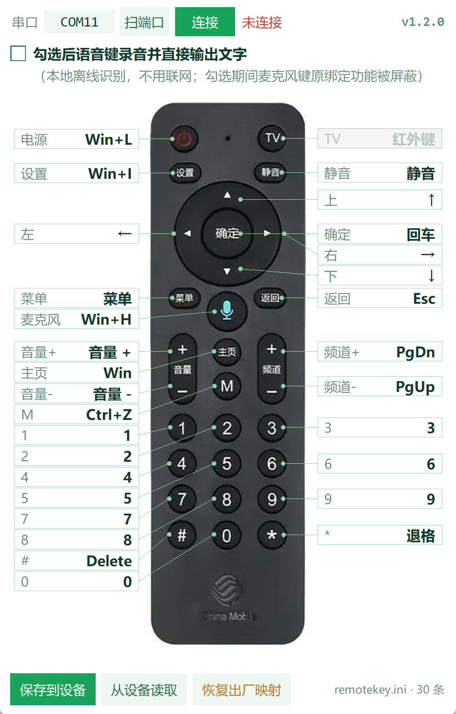

# 本地离线语音转文字（ASR）

勾上界面第二行那个勾，**按住遥控器语音键说话、松手，文字直接出现在光标处**。
全程离线：不联网、不装驱动、不占用系统麦克风设备，也不弹 Windows 自带的语音输入框。



---

## 怎么用

1. 连上设备（左上角选串口 → 「连接」，状态显示已连接）；
2. 勾选 **「勾选后语音键录音并直接输出文字」**；
3. 把光标点进记事本、微信、浏览器地址栏等任何能输入文字的地方；
4. **按住**遥控器上的麦克风键说话，**松开**后 1 秒左右文字就上屏。

勾选期间，语音键原来的绑定（默认 `Win+H`）会被**屏蔽**：

- 界面上「麦克风」这张卡片整块变灰，点击不弹改键窗口；
- 全局键盘钩子把这一组合键吞掉，系统不会弹出自己的语音键入框；
- 取消勾选立刻恢复原绑定，卡片颜色和改键功能同时回来。

输出的中文走「剪贴板 + Ctrl+V」，因为 HID 键盘只能打 ASCII，直接敲中文是不可能做到的。
注入完成后会把你原来的剪贴板内容放回去。

---

## 链路

```
遥控器麦克风
  │  BLE notify（0xFC 语音数据通道，非阻塞发送）
  ▼
ESP32-S3 固件 ── CDC 串口 ──► PC
  │  每帧 48 字节，靠 3 条 20 字节通知拼成
  ▼
Framer  按 seq 分组拼帧（丢碎片是常态，跨 seq 拼会解出乱七八糟的声音）
  ▼
dewhite  字节交换 + 去白化（XOR 0x0416）→ 40 字节 G.722.1 / Siren 7 码流
  ▼
decode.exe   libg722_1，16 kbps → 16 kHz 单声道 PCM
  ▼
预处理   去直流 → 剁掉开麦噪声 → 掐首尾静音 → RMS 归一化
  ▼
sherpa-onnx + Paraformer-zh-small（int8）  → 文字
  ▼
剪贴板 + Ctrl+V  →  当前光标
```

音频是 **G.722.1 / Siren 7 @ 16 kbps**，20 ms 一帧、每帧 20 字节，
解码后是 16 kHz 单声道 16 bit PCM。这条链路带宽只有 50–7000 Hz，本身就有损。

---

## 为什么必须做预处理

设备每次开麦，开头 0–350 ms 是这样的：

- 底噪 RMS 0.01–0.03
- 一下爆音，峰值 0.2–0.4
- 而真正的说话声 RMS 只有 0.005–0.01

也就是说**开麦头比人声响 20 倍**。直接把这段丢给模型，它会认真地把噪声听成字——
实测中说过「今天的天气」会被识别成「**七**今天的天」，「明天星期一」变成「**七**明天星期一」。
这个「七」不是上一句的残留，就是这段噪声。

用模型自带的干净测试音频做过对照：干净音频识别全对（含中英混、四川话、天津话），
往干净音频前插 1 秒静音 + 一个合成爆音也不受影响。所以问题在输入，不在模型。

现在的处理（`asr_win.py` 的 `prepare_audio`）：

| 步骤 | 做法 | 解决什么 |
|---|---|---|
| 去直流 | 减均值 | 爆音常带直流台阶，会污染后面的能量判断 |
| 剁头 | 固定切掉前 **300 ms**（短句按 25%） | 干掉落噪声被听成的字 |
| 爆音置零 | 尖峰附近清零 | 残留的瞬时冲击 |
| VAD 裁剪 | 掐掉首尾静音，起点前留 60 ms、尾部留 400 ms | 首字声母被切、末字被吞 |
| 归一化 | 按 **RMS** 而非峰值，上限 30 倍 | 峰值被爆音带偏，人声其实很小 |

效果对比（同一批真实录音）：

| 样本 | 处理前 | 处理后 |
|---|---|---|
| `take_verify_0031` | 喂测试 | **测试** |
| `take_probe_dump1` | 五喂喂喂喂一二三… | **喂喂喂喂一二三…** |
| `take_rest3_r2` | 四测试二二三四… | **测试二二三四…** |
| 纯噪声样本 | 「好的我的好的」 | 判为**全是静音**，不输出 |

---

## 分句与超时

- **分句**：500 ms 没有新帧就认为这句说完了。太短会把松手后设备还在吐的尾巴帧
  算到下一句开头——听起来就是"上一句最后一个字跑到下一句"。
- **最长一句** 20 秒，防止一直说话把缓冲撑爆。
- **硬超时 15 秒**：`onnxruntime` 的 `decode_stream()` 是纯 C 调用，一旦走进病态路径
  （中文模型遇到英文容易重复 token 或超长序列）就不返回，Python 杀不掉，还会一直攥着锁，
  后面每句都排队等它。所以到点直接**放弃这一句**：代次 +1、重建识别器、
  迟到的结果按代次校验丢弃，下一句立刻能正常识别。

---

## 性能（本机实测，i5 级 CPU）

| 指标 | 数值 |
|---|---|
| 模型加载 | 约 1.0 s（首次开启勾选时预热） |
| 识别 RTF（实时率） | 0.010–0.013，即 10 秒语音约 0.1–0.13 秒算完 |
| 单句额外开销 | `decode.exe` 调用约 30–60 ms |
| 绿色包体积 | 177 MB（模型 78 MB + onnxruntime 18 MB 占大头） |

---

## 已知限制

1. **只认中文**。模型是 `paraformer-zh-small`，说英文会输出怪字，甚至走进超时路径——
   15 秒熔断就是为这个加的兜底。
2. **音质上限由编码决定**。16 kbps 的 G.722.1 本身就窄带，叠加空口丢碎片
   （实测遥控器只发出按住时长的 25%–95%，无规律），识别率的天花板在这里，
   不在模型大小。
3. **注入需要中文输入法**不能处于特殊状态，且目标程序若以管理员运行，
   本程序也要以管理员运行（否则钩子和 `SendInput` 都够不到它）。
4. **必须整包运行**。模型在 `_internal/models/`，`decode.exe` 在 `_internal/tools/libg7221/`，
   只拷 exe 会没有语音功能。

---

## 出问题时

程序目录下会生成 `asr_debug.log`（超 256 KB 自动重建），每次识别一行：

```
码流3.24s 音频2.61s 剁头 0~300ms，裁到 0.30~2.85s，增益 x4.2 → 「今天的天气」
```

能看出这段音频多长、被剁掉多少、识别成什么。反馈问题请带上这个文件和
`--diag` 的输出。

---

## 许可

- 识别框架 **sherpa-onnx 2.0.1**：Apache-2.0
- 模型权重 **Paraformer-zh-small**：上游 ModelScope 模型卡未标注许可证，本项目不再授权
- 解码器 **libg722_1 v0.2.0**：GPL-2.0（`decode.exe` 独立进程，源码见 `tools/g7221-decoder/`）
- **G.722.1 涉及 Polycom 专利**，商用前请自行确认许可

完整清单与核对方法见 [`third-party.md`](third-party.md)。
